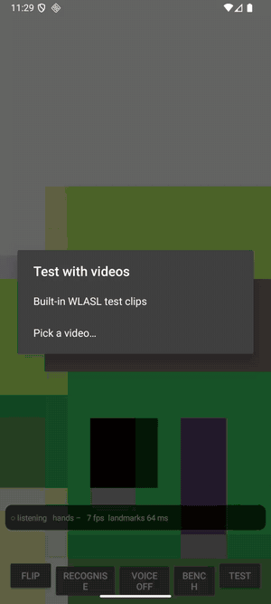
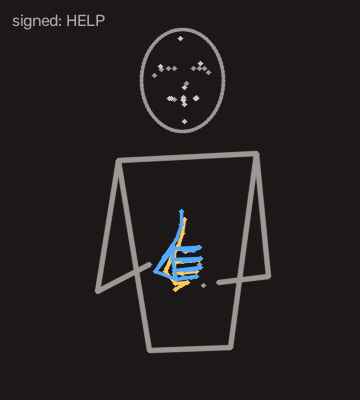

# EchoGesture

Sign language to text, live, on a phone, with no internet.

Point the phone camera at someone signing an American Sign Language (ASL)
word and the word appears on screen (and can be spoken aloud). Everything runs
on the phone itself: no server, no upload, no network permission.

Built for the **Samsung PRISM XR Hackathon 2026, Track 02 - "EchoGesture: Sign
Language Prediction on Edge Device"**.

| | |
|---|---|
| **Android app (APK)** | [EchoGesture-arm64.apk](https://github.com/Amritha902/xr/releases/latest/download/EchoGesture-arm64.apk) - any 64-bit Android phone, Android 8+ |
| **How to use it** | [docs/USER_GUIDE.md](docs/USER_GUIDE.md) - install, set up, sign, buttons, troubleshooting |
| **Demo video** | _coming soon (recording on a Galaxy A36)_ |
| **Full technical record** | [docs/DETAILS.md](docs/DETAILS.md) |

## Why

Most deaf and hard-of-hearing people sign, and most hearing people don't.
Cloud translation needs a connection and sends video of people to a server.
EchoGesture does it on the device: private, works offline, and fast enough to
keep up with a conversation one word at a time.

## See it work

| The app on Android (built-in test clips) | What the model sees, and what it says |
|---|---|
|  |  |
| 10 clips from the official test set, run through the full on-phone pipeline: 9/10 correct, same answers as the Python version. | Real test clips drawn as the body and hand points the model uses (no video, so no faces). The caption is what the shipped model predicts. |

## What it does

- **Live captions** from the camera. A word is shown as a caption when the
  model is sure (probability at least 45% and 20 points ahead of the next
  word); these are right about 95% of the time. Weaker guesses appear in grey
  as "word?" with the next two candidates. Hands resting in view never produce
  a word.
- **Near or far.** Works with the phone at arm's length (shoulders out of
  frame) or with the signer small in the frame. Too close: it tells you to move
  back.
- **Low light.** Turns on the torch (back camera) or a white ring light on the
  screen (front camera) when the scene is dark.
- **Voice.** Optional offline text-to-speech of each word.
- **Test mode.** Run the built-in test clips or any video on the phone.
- **Bench mode.** Logs latency, power and temperature for 10 minutes and saves
  a `results_device.csv`.

Vocabulary: the 100 words of WLASL100, the list the organisers asked for.

## How it works

```
camera frame -> MediaPipe Holistic -> 88 body, hand and face points
             -> sign start/end detection (hand movement)
             -> features (hand shape, orientation, location vs the body, motion, face)
             -> INT8 neural network -> word + confidence -> caption / speech
```

Working from body points instead of raw pixels keeps the model small and
makes it less sensitive to background, clothing and lighting.

## The model

| | |
|---|---|
| Type | Ensemble of 4 networks (1D convolutions + attention), averaged |
| Parameters | 5.1 M (1.28 M per network) |
| File | `models/model_int8.onnx`, INT8 ONNX, **6.2 MB** |
| Input | 32 time steps of 239 features computed from the landmarks |
| Output | 100 words |
| Runs on | ONNX Runtime (Android and desktop) |

The four networks differ in what they were trained on:

1. **Base** - WLASL training clips.
2. **Near/far** - the same plus copies with the phone close (shoulders cut off) or far away.
3. **Degraded** - plus copies from darkened, blurred and low-resolution video.
4. **Pre-trained** - first trained on 94,477 phone recordings from Kaggle's
   ASL Signs dataset (250 signs), then on WLASL.

Data: 1,466 WLASL100 clips (1,044 train, 221 validation, 201 test), split so
that validation signers never appear in training.

## Results

Targets are from the hackathon brief.

| Metric | Target | Measured | |
|---|---|---|---|
| Top-1 accuracy, **people the model never saw** | >= 70% | **78.1%** | PASS |
| Model size | <= 20 MB | **6.2 MB** | PASS |
| Accuracy drop under dark, blur, tilt, low resolution | <= 5 points | **4.8** | PASS |
| Latency per frame (phone) | <= 50 ms | not measured on a phone yet | - |
| Average power (phone) | <= 500 mW | not measured on a phone yet | - |
| Thermal drift over 10 min | <= 20% | not measured on a phone yet | - |

The file the judges read: [`results/results.csv`](results/results.csv).
Predictions for every official test clip: [`results/predictions.jsonl`](results/predictions.jsonl).

## What we tested

| Test | How | Result |
|---|---|---|
| New people | 3 groups of signers removed from all training, models retrained, scored once (622 clips) | 78.1% top-1, 93.1% top-5 |
| Official WLASL100 test clips | 201 clips through `main.py` | 164/201 = 81.6% |
| Bad video | 422 clips darkened, blurred, tilted 15 degrees and shrunk, then re-run through MediaPipe | drop 4.8 points (dark -5.0, blur -7.8, tilt +0.7, low res -7.3) |
| Noisy landmarks | jitter, missing hands, side view, etc. | drop 1.1 points |
| Phone at arm's length | shoulders off-screen, face 30% of the frame | 71.9% |
| Phone very close | face 50% of the frame | 40.7% - app asks to move back |
| Signer far away | signer at 1/2 and 1/3 size | 76.9% / 77.2% |
| Phone = computer | Kotlin feature code vs Python on 14 recorded cases | max difference ~1e-6 |
| App end to end | built-in test on the Android emulator | 9/10, identical to Python |
| Live path | test clips streamed through the app's sign detection + caption rule at ~12 fps (`scripts/live_sim.py`) | sign found 91.5%, correct caption 61.7% (was 50.7%), idle hands: 0 words in 600 runs |
| Offline | Docker container with `--network none`; app has no internet permission | works |
| Unit tests | `pytest` (16) and Android `FeaturesTest` / `EnhanceTest` | all pass |

Honest notes:

- The recipe (near/far and degraded training) was picked after looking at
  earlier held-out results, so 78.1% is a little optimistic.
- WLASL has only ~10 clips per word; one new person can score much higher or
  lower than the average.
- Phone latency, power and heat need a run on a real phone (Bench button).

## Run it

**On a phone:** install the APK above and follow the [user guide](docs/USER_GUIDE.md).

**On a computer:**

```bash
pip install -r requirements-inference.txt
python main.py --videos path/to/clips --out results/predictions.jsonl
```

```python
from main import predict
predict("clip.mp4")  # {"prediction": "BIRD", "confidence": 0.87, "top5": [...], ...}
```

**With Docker (no network):**

```bash
docker build -t echogesture .
docker run --rm --network none -v "$PWD/clips:/clips" -v "$PWD/out:/out" echogesture --videos /clips --out /out/predictions.jsonl
```

**Build the app:** `cd android && ./gradlew assembleDebug`.

Training from scratch, data download and every experiment are in
[docs/DETAILS.md](docs/DETAILS.md).

## Repository

```
main.py              predict(video) and batch predictions
echogesture/         landmarks, features, model, augmentation
scripts/             data download, training, export, evaluation
android/             the app (Kotlin, CameraX, MediaPipe, ONNX Runtime)
models/              shipped INT8 model + word list
results/             results.csv, predictions.jsonl, robustness files
docs/                full technical record, media
```

## Team

Amritha S
