<div align="center">

# Palmcast

**Sign language to text and speech, live, on the phone. No internet. No cloud.**

Team **WeCode** · VIT Chennai · Samsung PRISM XR Hackathon 2026 · Track 02 - *EchoGesture: Sign Language Prediction on Edge Device*


[](https://youtu.be/aDAs7t2xOe0)

**[Download the app](https://github.com/yugesh1111/xr/releases/latest/download/Palmcast-arm64.apk)** ·
**[Demo video (YouTube)](https://youtu.be/aDAs7t2xOe0)** ·
**[Slides](submission/Palmcast_XR_Hackathon_Track02.pptx)** ·
**[User guide](docs/USER_GUIDE.md)** ·
**[Screenshots](docs/implementation/README.md)** ·
**[Technical record](docs/DETAILS.md)**

[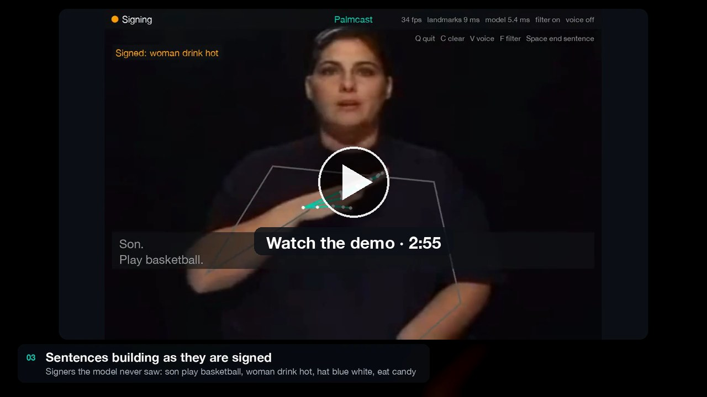](https://youtu.be/aDAs7t2xOe0)

*Click the picture to watch the 2:57 demo on YouTube.*

</div>

---

Point a phone at someone signing American Sign Language, or Indian Sign
Language, and their words appear on screen, one sign at a time, and can be
spoken aloud. Users can also teach the phone their own signs in a few seconds. The hearing person can
answer by voice, and their words appear as captions. Everything runs on the
phone: the app has no internet permission, so video of people never leaves the
device.

## What it does

Most impressive first. Every number is measured; the files are in [`results/`](results).

1. **Reads people it has never seen.** 100 ASL words (WLASL100): **78.1%** top-1 on signers held out of
   training, 81.6% on the official test set. Target was 70%.
2. **Runs entirely on the phone.** No internet permission at all. The ASL word model is **6.2 MB** INT8 (+ a
   0.23 MB sign gate); **14 ms** per camera frame, well under the 50 ms limit.
3. **Indian Sign Language too.** One switch in the Test menu: 50 ISL words (INCLUDE-50), **99%** on its test
   set and **10 of 10** on the phone. On YouTube signers it never saw it is at 45%, and we say so.
4. **Teach it a new sign.** Type the word, sign it 3 times, and the phone knows it. No retraining, nothing
   uploaded; meant for your own name sign or home signs.
5. **Whole sentences, not one word per button press.** Signs are cut at natural pauses and join into a
   running sentence; a 4 s pause ends it. **20 of 30** words right in the 10-sentence test.
6. **A real two-way conversation.** Sure words are spoken with an offline voice; the hearing person taps
   **Reply** and talks, and their words appear as captions.
7. **Quiet when nobody is signing.** A 0.23 MB sign gate and a jitter filter: resting or fidgeting hands gave
   **0 false words in 600** tries.
8. **Holds up in bad video.** Dark, blurry, tilted, low-resolution or partly blocked: only **4.6 points** lost.
   Torch or a white screen ring in low light, sharpening for blur, a hint when you are too close, 77% with
   the signer at a third of the size, left-handed signers mirrored.
9. **Not tied to the camera.** Upload any video and it is read frame by frame: 6 of 9 clips from 9 different
   websites right.
10. **The phone and the Python code agree.** Built-in tests replay dataset clips on the phone: ASL **9 of 10**,
    ISL **10 of 10**, every answer identical to the evaluated Python pipeline.
11. **Measures itself.** Test → Measure runs 10 minutes and logs latency, power and heat on the phone.
12. **Ready for the judges.** `predict()` in [`main.py`](main.py), `predictions.jsonl`, `results.csv`,
    Python 3.11, and a Docker image that runs with `--network none`.

Screenshots of each one: [docs/implementation](docs/implementation/README.md).

## Submission checklist

| Asked for | Where |
|---|---|
| Submission package (`team_name.zip`: `src/` + `results/`) | [`submission/WeCode.zip`](submission/WeCode.zip) |
| Source code | this repository: [`main.py`](main.py) (`predict()`), [`echogesture/`](echogesture), [`scripts/`](scripts), [`android/`](android) |
| Presentation | [`submission/Palmcast_XR_Hackathon_Track02.pptx`](submission/Palmcast_XR_Hackathon_Track02.pptx) |
| Video | **[YouTube](https://youtu.be/aDAs7t2xOe0)** (2:57), same file in the repository: [`submission/Palmcast_demo_final.mp4`](submission/Palmcast_demo_final.mp4) |
| README | this page, plus the [user guide](docs/USER_GUIDE.md) and [technical record](docs/DETAILS.md) |
| APK | [`Palmcast-arm64.apk`](https://github.com/yugesh1111/xr/releases/latest/download/Palmcast-arm64.apk) · [`Palmcast-armv7.apk`](https://github.com/yugesh1111/xr/releases/latest/download/Palmcast-armv7.apk) · [emulator APK](https://github.com/yugesh1111/xr/releases/latest/download/Palmcast-x86_64-emulator.apk) ([release page](https://github.com/yugesh1111/xr/releases/latest)) |
| Results | [`results/results.csv`](results/results.csv), [`results/predictions.jsonl`](results/predictions.jsonl) |

## Palmcast reading people it has never seen

Each GIF is the live pipeline on test signers that were never in training: the hands are tracked, each sign is cut out at a pause, and the words join into a sentence.

| "Son play basketball" | "Woman drink hot" |
|:---:|:---:|
| 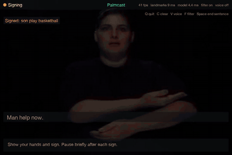 | 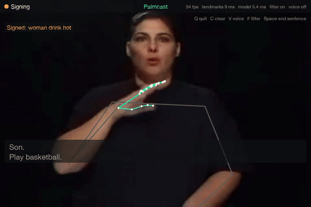 |
| **"Hat blue white"** | **"Eat candy"** |
| 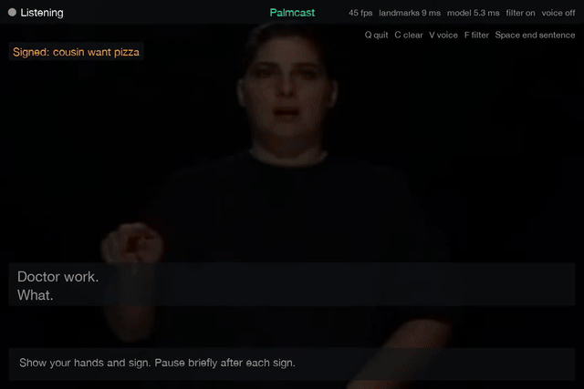 | 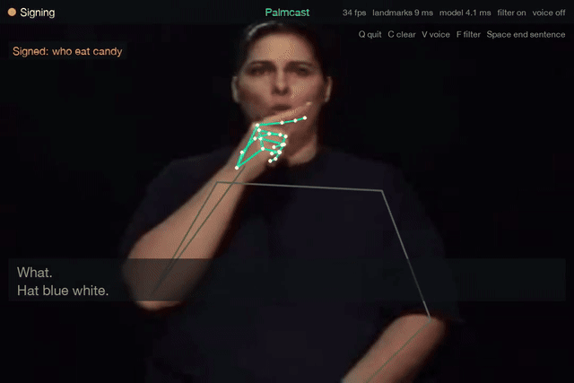 |

## See it work

| Live: signing "help" | Online ASL video uploaded into the app | 30-clip sentence test |
|:---:|:---:|:---:|
| 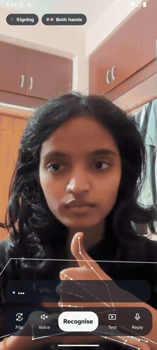 | 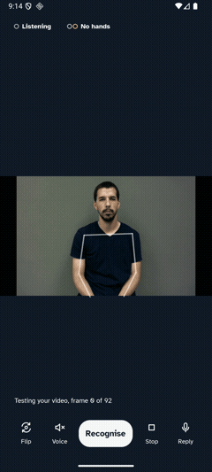 | 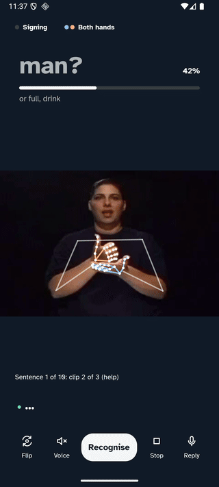 |
| Hands tracked live; **help** at 54%, then a grey guess | A clip from aslbricks.org read by the app: **basketball 81%** | Words build into sentences: **20 of 30** right |

All three are screen recordings of the release APK on the Android emulator
(the laptop camera is the phone camera).
**[Demo video, 2:57, with voice-over](https://youtu.be/aDAs7t2xOe0)** (on YouTube): real
screen recordings only - live camera, the on-device architecture, signers the model never saw, a web video uploaded
into the app, the sentence test, the built-in test, Indian Sign Language mode, teaching the phone a new sign and `predict()`
([speech script](submission/SPEECH_SCRIPT.md)).

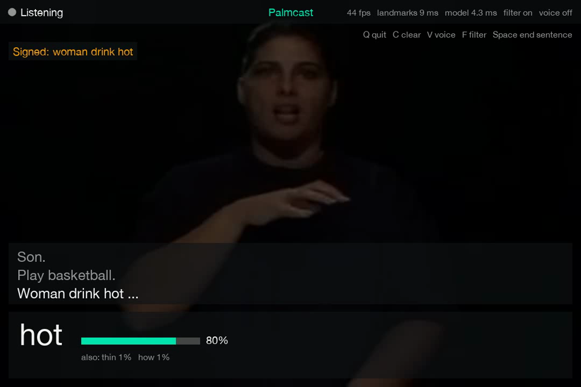

*The same pipeline on a laptop (`python live.py --demo`): test signers never
seen in training, words joining into "Woman drink hot." as they are signed.*

## Results

Targets from the Track 02 brief; the file the judges read is
[`results/results.csv`](results/results.csv).

| Metric | Target | Palmcast | |
|---|---|---|:---:|
| Top-1 accuracy on **people the model never saw** | ≥ 70% | **78.1%** (official test set: 81.6%) | ✅ |
| Model size, INT8 | ≤ 20 MB | **6.2 MB** (+ 0.23 MB sign gate) | ✅ |
| Latency p95 per camera frame | ≤ 50 ms | **14.0 ms**, word model 5.4 ms per sign | ✅ * |
| Accuracy drop: dark, blur, tilt, low resolution, occlusion | ≤ 5 pt | **4.6 pt** | ✅ |
| Thermal drift over 10 minutes | ≤ 20% | **5.3%** | ✅ * |
| Average power | ≤ 500 mW | needs a phone run | ⏳ |

\* 10-minute sustained run of the full pipeline on a laptop CPU (Apple M5,
[`scripts/sustained_run.py`](scripts/sustained_run.py)), not a phone. The app's
**Test → Measure** mode records the same numbers, and power, on a phone.

## Indian Sign Language, and signs you teach the phone

**ISL mode** (Test → Switch to Indian Sign Language). A second word model for
the 50 words of [INCLUDE-50](https://zenodo.org/records/4010759) (AI4Bharat,
CC BY 4.0), signed by deaf students of St. Louis School for the Deaf, Adyar,
Chennai. Same pipeline as ASL; only the training data changes.

| ISL test | Result |
|---|---|
| INCLUDE-50 official test split (192 clips; same studio and signers as training) | **99.0%** top-1 |
| **Signers from outside INCLUDE**: 40 single-word ISL videos from YouTube dictionary channels, 26 words, used only for testing and scored once ([list](results/isl_external_clips.csv)) | **45.0%** top-1 (95% CI 31-60%), **72.5%** top-5; chance is 2% |
| Built-in ISL test on the phone (10 INCLUDE test clips) | **10 of 10**, same answer as Python on all 10 |
| ISL word model | 3-network ensemble, **4.4 MB** INT8, 1.8 ms per sign on a laptop CPU |

The 99% is the easy case. On new people the ISL model is at 45%: INCLUDE has
only a handful of signers, all from one school, and ISL signs vary between
regions (several YouTube channels show two variants of the same word). More
signers in training is the fix; the app and pipeline do not change.

**Teach the phone a new sign** (Test → Teach the phone a new sign). Type the
word and sign it 3 times. The phone keeps the word model's embedding of each
recording (192 numbers) and from then on recognises that sign, with no
retraining and nothing leaving the phone. A bank of 1,000 ordinary signs that
ships with the app keeps everyday signing from being taken for a taught word
([`CustomSigns.kt`](android/app/src/main/java/com/echogesture/core/CustomSigns.kt),
[`eval_teach.py`](scripts/eval_teach.py)). Measured on Kaggle ASL signs the
model never trained on, 10 words taught at a time, 40 trials:

| Who signs it later | Nearest taught word right | Shown, right word | Shown, wrong word | Untaught sign taken for a taught one |
|---|---|---|---|---|
| The person who taught it | 86.5% | **60.8%** | 1.7% | 4.9% |
| Someone else | 52.5% | 15.8% | 4.2% | 4.8% |

So it is a personal feature: teach your own name sign or a home sign, and the
phone learns it from you.

## What the track asks for, and where it is

| Track 02 asks for | Palmcast | Evidence |
|---|---|---|
| Fully on-device, exocentric: phone camera → text or audio | Android app, back camera by default; captions + offline voice | APK, demo video |
| Moving heads, angled signers, low light | Body-relative features, view augmentation, torch / screen ring light | robustness 4.6 pt |
| On-device privacy, zero cloud streaming | No `INTERNET` permission; nothing stored or sent | [`AndroidManifest.xml`](android/app/src/main/AndroidManifest.xml) |
| Pose-invariant 3D hand features | Hand shape in the hand's own frame, location in the body's frame | [`features.py`](echogesture/features.py), `Features.kt` |
| Quantized TFLite / ONNX model, < 20 MB INT8 | ONNX INT8, static per-channel | [`models/`](models), [`export_onnx.py`](scripts/export_onnx.py) |
| Captions or audio for two-way conversation | Captions, voice, **Reply** turns speech into captions | demo video |
| `predict()`, `predictions.jsonl`, `results.csv` | [`main.py`](main.py); 201 official test clips; 5 of 6 PASS | [`results/`](results) |
| Occlusions and HUD clarity | Occlusion test −4.0 pt; confidence bar, hints, conversation view | [`robustness_video_enhanced.json`](results/robustness_video_enhanced.json) |
| Python 3.11, `requirements.txt`, zip layout | Checked on 3.11.15; Docker on 3.11 | [`submission/`](submission) |

## How it works

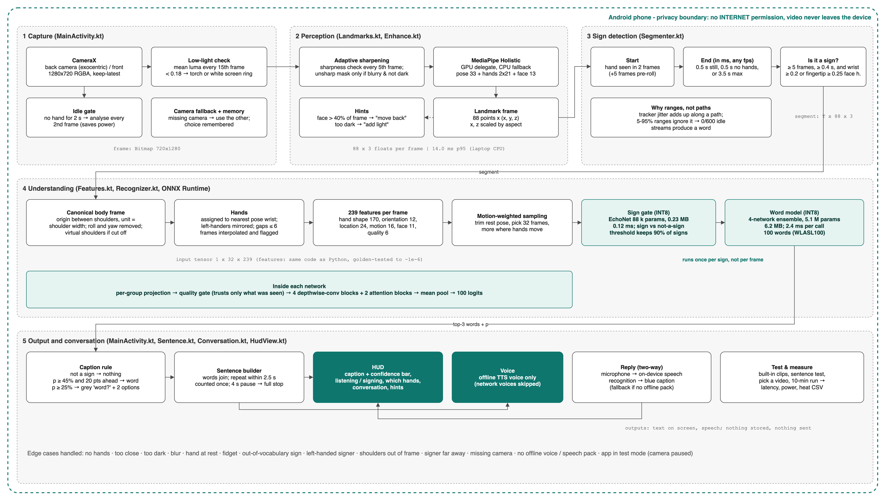

1. **Capture** - CameraX at 720p; low-light check switches on the torch or a white ring on the screen.
2. **Perception** - MediaPipe Holistic finds 88 body, hand and face points; blurry frames are sharpened first.
3. **Sign detection** - a One Euro filter first removes tracker jitter from every landmark (strong smoothing on still points, almost none on fast ones). A sign starts when a hand appears and ends after a 0.5 s pause; it only counts if the wrist or fingers really moved (resting hands never trigger it).
4. **Understanding** - 239 body-relative features per frame, 32 frames per sign. A 0.23 MB **sign gate** asks "is this a sign at all?", then the 6.2 MB INT8 **word model** (4 networks averaged) picks one of 100 words.
5. **Output** - sure words become captions and are spoken; weaker ones show as a grey `word?` with two alternatives; words join a running sentence. **Reply** turns the other person's speech into captions.

Working from body points instead of pixels keeps the model small and fast, and
makes it indifferent to background, clothing and skin tone.

<details>
<summary><b>Training and evaluation pipeline</b></summary>

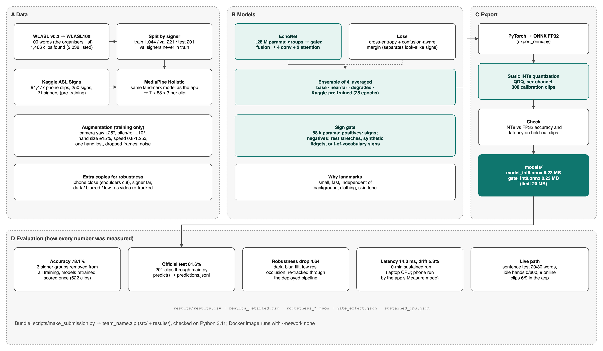

- **Data:** WLASL100 - 1,466 clips of 100 words, split by signer (1,044 / 221 / 201), plus 94,477 Kaggle ASL Signs phone clips for pre-training.
- **Four networks**, each 1.28 M parameters (per-group projections → quality gate → 4 depthwise-conv + 2 attention blocks): base, near/far (phone close or far away), degraded video, and Kaggle-pre-trained.
- **Augmentation:** camera angle, hand size, speed, one hand lost, dropped frames, tracker noise.
- **Export:** PyTorch → ONNX → static INT8 (QDQ, per-channel), checked against FP32.

</details>

<details>
<summary><b>Per-frame decision flow and edge cases</b></summary>

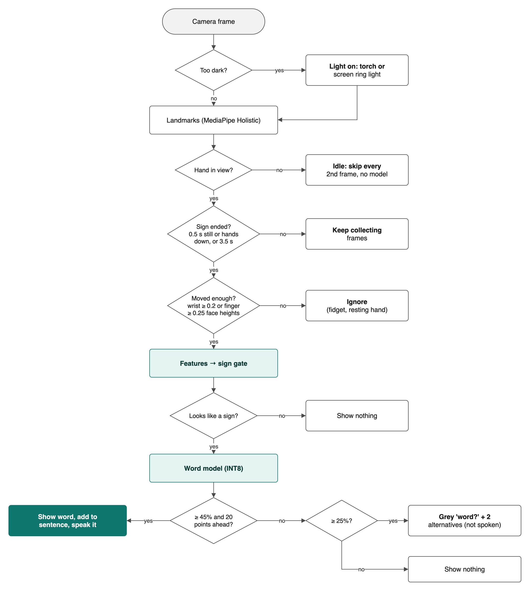

| Edge case | What the app does |
|---|---|
| No hands in view | Listening; every 2nd frame skipped to save power |
| Hands resting, fidgeting | Movement-range check + sign gate → no word (0 of 600 idle runs) |
| Unsure sign | Grey `word?` + 2 alternatives, not spoken |
| Sign outside the 100 words | Sign gate / low confidence → nothing |
| Too dark | Torch or screen ring light, and a hint |
| Blurry frame | Adaptive sharpening before tracking |
| Too close | "Move the phone back" hint |
| Shoulders out of frame | Virtual shoulders placed from the face |
| Signer far away | Trained on far copies: 77% at ⅓ size |
| Left-handed signer | Mirrored to the dominant hand |
| Something passes in front | Tested: −4.0 points |
| No camera / offline voice / speech pack | Falls back and tells the user |

</details>

## What we tested

| Test | Result |
|---|---|
| 3 groups of signers removed from all training, models retrained, scored once (622 clips) | **78.1%** top-1, 93.1% top-5 |
| Official WLASL100 test clips through `main.py` (201) | **81.6%** |
| Video corruptions re-run through MediaPipe (422 clips): dark, blur, tilt 15°, low resolution, occlusion | drop **4.6 pt** (−5.0, −7.8, +1.0, −7.3, −4.0) |
| 9 online ASL videos, one per website, uploaded into the app | **6 of 9** (app and `main.py`), 7 of 9 in Docker |
| 30 test clips as 10 sentences, through the live pipeline in the app | **20 of 30** words right and in order |
| Built-in test, 10 official clips on the phone | **9 of 10**, identical to Python |
| Live signing to the camera | **help** at 54% |
| Hands resting / fidgeting (600 simulated streams) | **0** false words |
| Landmark filter, with webcam-like tracker jitter (0.4-0.8% of the image) | false words from resting hands 140/600 → **0/600**; 3-sign sentences right and in order 32.8% → **49.4%**; on clean dataset video it costs ~1 point |
| Same pipeline on a laptop, `python live.py --check` (30 clips, 10 sentences) | **19 of 30** (filter on), 20 of 30 (off); landmarks 10 ms per frame on an M-series CPU |
| Phone at arm's length / very close / signer at ½ and ⅓ size | 71.9% / 40.7% (app asks to move back) / 76.9% / 77.2% |
| Kotlin features vs Python | max difference ~1e-6 |
| Kotlin landmark filter vs Python | max difference 2.4e-7 |
| ISL: INCLUDE-50 test / outside signers from YouTube / built-in on the phone | 99.0% / **45.0%** (top-5 72.5%) / 10 of 10 |
| Teach a sign (3 recordings), same person / another person | 60.8% / 15.8% shown right, under 5% false accepts |
| Unit tests: `pytest` (16), Android `FeaturesTest`, `EnhanceTest`, `SegmenterTest`, `SentenceTest`, `LandmarkFilterTest`, `CustomSignsTest` | all pass |

**Honest notes.** The training recipe was chosen after seeing earlier held-out
results, so 78.1% is slightly optimistic. WLASL has only ~10 clips per word, so
one new person can score well above or below the average. Latency and thermal
drift were measured on a laptop CPU; power needs a phone.

## Run it

**1. On a phone (the product).** Download
[`Palmcast-arm64.apk`](https://github.com/yugesh1111/xr/releases/latest/download/Palmcast-arm64.apk)
(older 32-bit phones: [`Palmcast-armv7.apk`](https://github.com/yugesh1111/xr/releases/latest/download/Palmcast-armv7.apk)),
install it (Android 8+) and follow the [user guide](docs/USER_GUIDE.md).
**OPPO / Realme / OnePlus (ColorOS):** allow installs from Chrome or Files,
tap *Install anyway* at the security check, and install an offline English
voice for speech - [step by step](docs/USER_GUIDE.md#on-an-oppo-phone-coloros-also-realme-and-oneplus).

**2. Python** (the brief's `predict()`, Python 3.11):

```bash
pip install -r requirements-inference.txt
python main.py --videos path/to/clips --out results/predictions.jsonl
```

```python
from main import predict
predict("clip.mp4")
# {"clip_id": "clip", "prediction": "BIRD", "top5": [...], "confidence": 0.87, "latency_ms": 9.8, ...}
```

**3. Docker, fully offline:**

```bash
docker build -t palmcast .
docker run --rm --network none -v "$PWD/clips:/clips" -v "$PWD/out:/out" palmcast --videos /clips --out /out/predictions.jsonl
```

**4. Check the live pipeline on a laptop webcam** (same code path as the app, Python 3.11, fresh venv):

```bash
pip install -r requirements-live.txt
python live.py --check     # no camera: 30-clip sentence test, prints the score (~1 min)
python live.py             # webcam, real time; Q quits.  --demo plays 10 test sentences
```

Details and troubleshooting: [user guide, section 8](docs/USER_GUIDE.md#8-check-the-live-pipeline-on-a-laptop).

Build the app yourself: `cd android && ./gradlew assembleDebug`.
Submission bundle in the organisers' layout: `python scripts/make_submission.py --team WeCode`.
Training from scratch and every experiment: [docs/DETAILS.md](docs/DETAILS.md).

## Repository

```
main.py           predict(video) -> dict, batch predictions
live.py           the live pipeline on a laptop webcam (check / demo)
samples/          30 short test clips for live.py --check / --demo
echogesture/      landmarks, features, model, augmentation (Python)
android/          the app: Kotlin, CameraX, MediaPipe, ONNX Runtime
models/           INT8 word model, sign gate, word list
scripts/          data, training, export, evaluation, measurement
results/          results.csv, predictions.jsonl, robustness and gate reports
submission/       slides, demo videos, speech script, diagrams (draw.io)
docs/             user guide, full technical record, media
```

## Team WeCode - VIT Chennai

| Name | Register number |
|---|---|
| Amritha S | 23BEC1368 |
| Yugeshwaran P | 23BEC1404 |
