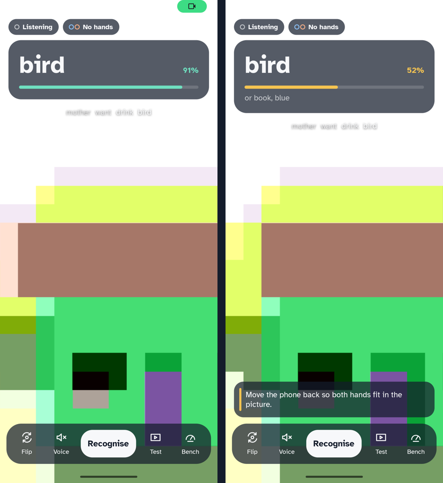

# Palmcast - how to use the app

## 1. Install

1. On the phone, open the [APK link](https://github.com/yugesh1111/xr/releases/latest/download/Palmcast-arm64.apk) and download it.
2. Tap the downloaded file. If Android says the source isn't allowed, tap
   **Settings**, turn on **Allow from this source**, go back, tap **Install**.
3. If Play Protect warns about an unknown app, tap **Install anyway**
   (the app is not on the Play Store, that is all the warning means).
4. Open **Palmcast** and tap **Allow** for the camera. That is the only
   permission it asks for. It never uses the internet.

Needs an Android phone with Android 8 or newer. Almost every phone since 2019
is 64-bit (`Palmcast-arm64.apk`); for an older 32-bit phone use
[`Palmcast-armv7.apk`](https://github.com/yugesh1111/xr/releases/latest/download/Palmcast-armv7.apk).

### On an OPPO phone (ColorOS), also Realme and OnePlus

ColorOS adds a few extra checks. All of them are one tap:

1. Download the APK in Chrome. Open it from the Chrome download bar or from
   **Files > Downloads**.
2. **"For your security, installing unknown apps is not allowed"** - tap
   **Settings**, switch on **Allow from this source** for Chrome (or Files),
   then press back.
3. **Security check / "Installing apps from unknown sources may harm your
   phone"** - tap **Install anyway**. If it asks for your OPPO account
   password, that is ColorOS's own check: enter it, or choose
   **Skip/Install without verification** where offered.
4. Open Palmcast, allow the camera.
5. **Voice:** ColorOS phones often ship without an English offline voice. If
   the words are not spoken: install **Speech Services by Google** from the
   Play Store, then **Settings > Additional settings > Languages & input >
   Text-to-speech output**, choose Speech Services by Google, tap the gear >
   **Install voice data > English (United States)**. The app shows a hint
   when no offline voice is installed.
6. **Measuring power (Test > Measure):** ColorOS stops apps in the background
   to save battery. Keep Palmcast on screen during the 10-minute run, and in
   **Settings > Battery > App battery management > Palmcast** choose
   **Allow background activity** so the run is not cut short.

Installing from a computer instead (USB cable):

1. **Settings > About device > Version**, tap **Build number** 7 times.
2. **Settings > Additional settings > Developer options**: turn on **USB
   debugging**, and also **Install via USB** if it is listed. If installing
   fails with `INSTALL_FAILED_USER_RESTRICTED`, turn on **Disable permission
   monitoring** in the same menu (ColorOS only), then try again.
3. Plug in, accept the "Allow USB debugging?" prompt on the phone, then:
   `adb install -r Palmcast-arm64.apk`

## 2. Set up

- Prop the phone up (a stand, a cup, a stack of books) so your hands stay free.
- **Back camera** (default): point the phone at the person signing to you and
  read their words. **Flip** to the front camera to sign to the phone yourself.
- Distance: your head, chest and both hands in view. Arm's length works;
  further away also works.
- Light: face a window or a lamp. If it's too dark the app turns on the
  torch (back camera) or a white ring around the screen (front camera).
- Plain background helps but is not required.

## 3. Sign

1. Start with your hands down.
2. Sign a word, then **hold still for about half a second** (or drop your
   hands). The word appears at the top with a confidence (%) and joins the
   sentence at the bottom.
3. Keep going word by word. Stop for 4 seconds and the sentence ends with a
   full stop; the next word starts a new one.

What you see on screen:

| On screen | Meaning |
|---|---|
| Word with a **mint** bar under it | sure (60% or more); the bar shows how sure |
| Word with a **marigold** bar + "or ..." | fairly sure; the next two guesses are listed |
| Grey **word?** + "or ..." | a guess: one of these three is usually right; not added to the history or spoken |
| Nothing | no sign found, the movement didn't look like a sign, or no real candidate - sign it again, a bit bigger |
| `Listening` / `Signing` (top left) | waiting / sign in progress (the dot pulses) |
| `Both hands` / `One hand` / `No hands` | which hands it can see; the blue and orange dots match the hand outlines drawn on screen |
| "Move the phone back..." (above the buttons) | too close, hands out of view |
| "Too dark..." | add light |
| Sentence at the bottom | the words so far; older sentences dimmed; mint dots while you sign. Tap it to clear |



It knows **100 words** (WLASL100): accident, africa, all, apple, basketball,
bed, before, bird, birthday, black, blue, book, bowling, brown, but, can,
candy, chair, change, cheat, city, clothes, color, computer, cook, cool, corn,
cousin, cow, dance, dark, deaf, decide, doctor, dog, drink, eat, enjoy,
family, fine, finish, fish, forget, full, give, go, graduate, hat, hearing,
help, hot, how, jacket, kiss, language, last, later, letter, like, man, many,
medicine, meet, mother, need, no, now, orange, paint, paper, pink, pizza,
play, pull, purple, right, same, school, secretary, shirt, short, son, study,
table, tall, tell, thanksgiving, thin, thursday, time, walk, want, what,
white, who, woman, work, wrong, year, yes.

## 4. Buttons

| Button | What it does |
|---|---|
| **Flip** | front / back camera |
| **Recognise** | give a word now for what you just signed (if it didn't show one by itself) |
| **Voice** | speak each word aloud (offline voice); the speaker icon shows on or off |
| **Reply** | the other person speaks their answer; their words appear in the conversation (blue marker). Tap **Done** to stop early. Uses the phone's on-device speech recognition |
| **Test** | test videos (see 5) and the 10-minute measurement run (see 6); tap **Stop** to end a test early |

## 5. Check it works (no signer needed)

**Test -> Built-in WLASL test clips.** Pauses the camera and runs 10 test
videos through the same pipeline (under a minute on a phone; progress shows
above the buttons). You get a list: each clip with the app's word and confidence, whether
the computer version agrees, and timing. Expected: 9 of 10 correct, all the same
as the computer.

**Test -> Sentence test.** Plays ten 3-word sentences (30 WLASL test clips)
through the live pipeline, with the video and hand outlines on screen, and
shows the sentence forming. Takes about 2 minutes. Expected: 20 of 30 words.

**Test -> Pick a video...** runs any video on the phone (one word per clip).

**Test -> Switch to Indian Sign Language (ISL).** The app now reads the 50
INCLUDE words (the chip at the top says ISL; the choice is remembered). In ISL
mode, **Test -> Built-in INCLUDE (ISL) test clips** runs 10 ISL test videos.
Expected: 10 of 10, all the same as the computer. The sentence test uses ASL
clips, so it only runs in ASL mode. Switch back the same way.

**Test -> Teach the phone a new sign.** Type the word (for example your name),
tap Start, and sign it 3 times with your hands down for a moment between them;
a chip at the top counts the recordings. Then sign it any time and the word
appears and is added to the sentence. **Test -> Signs you taught** lists them;
tap one to forget it. Taught signs are kept per language and never leave the
phone. Works best when the same person teaches and signs.

## 6. Measure speed, power and heat (for results.csv)

1. Charge the phone, then **unplug it** (power is read from the battery).
2. Tap **Test -> Measure speed, power and heat** (speed numbers appear above the buttons), then sign words continuously for **10 minutes**.
3. Tap **Test -> Stop measuring and save results**. A summary appears and a file is saved to
   `Android/data/com.echogesture.app/files/bench_<time>/results_device.csv`.
4. Copy that file to the computer (USB file transfer, or
   `adb pull /sdcard/Android/data/com.echogesture.app/files/`) into `results/`, then:

```bash
python scripts/make_results.py --eval runs/h100_ens12/eval_holdout_int8.json runs/h200_ens12/eval_holdout_int8.json runs/h300_ens12/eval_holdout_int8.json \
  --eval-test runs/f_ens4/eval_test_int8.json \
  --robustness results/robustness_landmark.json results/robustness_video_enhanced.json \
  --run-key f_base+f_nf+f_deg+f_e12p25 --robustness-level video_enhanced \
  --predictions results/predictions.jsonl --device results/results_device.csv
```

This fills the latency, power and thermal rows of `results/results.csv`.

## 7. If something is off

| Problem | Try |
|---|---|
| Black camera | close and reopen the app; check camera permission in Settings -> Apps -> Palmcast |
| `hands –` all the time | step back, more light, keep hands in front of your chest |
| No word appears | sign a bit bigger and slower, start and end with hands down, or tap **Recognise** |
| Wrong word | check it is one of the 100 words; sign facing the camera |
| App closes on start | reinstall the latest APK; tell us the phone model |

## 8. Check the live pipeline on a laptop

The phone is the product; the laptop is for checking it. `live.py` runs the
same pipeline as the app (Holistic landmarks → landmark filter → sign
segmenter → sign gate → INT8 model → caption rule → sentence → offline voice)
on a laptop webcam, so judges and teammates can try it without a phone.
Python 3.11, Windows, macOS or Linux:

```bash
git clone https://github.com/yugesh1111/xr && cd xr
python3.11 -m venv .venv
source .venv/bin/activate            # Windows: .venv\Scripts\activate
pip install -r requirements-live.txt
python live.py --check               # 1 minute, no camera: 30-clip sentence test, prints the score
python live.py                       # webcam, live; Q quits
```

- **No camera / no signer?** `python live.py --demo` plays the 10 test
  sentences (signers the model never saw) through the live window.
  `python live.py --video some_clip.mp4` does the same for any video.
- **Keys:** Q quit, C clear the sentence, V voice on/off, F landmark filter
  on/off (to see the jitter it removes), Space end the sentence now.
- **macOS:** the first run asks for camera access for your terminal app.
  If the window says it cannot open the camera, allow it in **System Settings
  > Privacy & Security > Camera** and run again. Another camera: `--camera 1`.
- **Signing tips:** sit so your head, chest and both hands are in view, sign
  one word, pause half a second, sign the next. A 4-second pause ends the
  sentence.
- Use a fresh virtual environment: this needs `opencv-python` (with windows),
  which clashes with the headless OpenCV in `requirements-inference.txt`.
